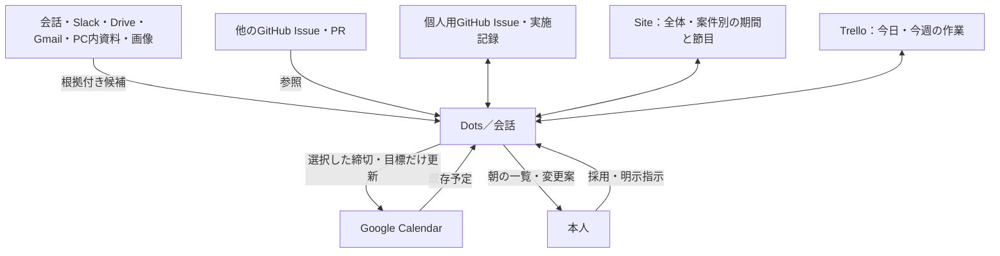
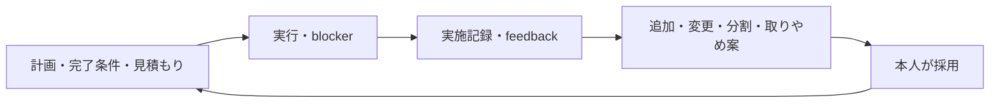

# タスク・タイムラインの運用

## 保存先と同期方向

GitHubの個人用Issueがタスクの正本。Siteは案件・節目・タスクの関連付けと同期結果を保存する。Siteでのタスク更新は外部操作が確認できるまで反映待ち。GitHubへの書き込み先は設定した個人用リポジトリに限定し、他のリポジトリは参照する。

表示は今週／1か月／3か月／6か月／全期間。同じタスクを複製しない。準備開始・目標・正式締切・提出を区別し、正式締切を準備の移動に連動させない。候補の出典と確認日を残し、メールの新旧、本人と他者の応募、未確認と確定、完了と取りやめを区別する。

## 見積もりと実施記録

1・2・3・5・8・13を相対見積もりに用いる。未見積もりはnull。ポイントを時間や重要度と換算しない。着手時の値を固定し、その後の変更は履歴に残す。事後推定は実績ポイントから除外する。8・13は分割や調査を検討する。チームごとに異なる尺度を合算しない。

完了条件とやったこと、成果物、blocker、feedback、学んだこと、見積もりとの差を残す。実作業時間は任意。未記録を0と見なさない。記録はIssueコメントに追加する。完了時の記録を先に保存してからIssueを閉じる。外部で閉じたIssueは振り返り未記入として補完できる。

AIの案はproposedで保存する。採用した案だけ操作キューへ入れる。取りやめも履歴を保持する。本人の明示指示は直接キューへ登録できる。親子タスクのポイントを二重集計しない。

## 会話・Dots向けの同期手順

1. `list_tasks`、`list_projects`、`get_planning_schema`を読む。未初期化なら、サーバー指定の本人が`initialize_owner`を実行する。設定と実データはSite DBに置く。公開ソースへ書かない。
2. `planning_mutate`の`ingest_snapshot`で取得結果を保存。各ソースを全ページ確認し、取り切れない結果はpartial、権限・通信失敗はerror、PC未接続はoffline。失敗で既存データを空にしない。GitHub Issue IDを安定したタスクIDとして扱い、managed metadataがあればそのIDを維持する。
3. 個人Issue本文の`edu-planning-task`メタデータを復元し、最新のGitHubタイトル・open/closed・closed reason・updatedAtを照合する。openは状態ラベル`planning:doing`／`planning:blocked`を参照し、その他はtodo。closed/not_plannedはcancelled。未管理のIssueでは本文をpurposeとして保ち、見積もりを推測で確定しない。コメントの`edu-planning-worklog`を取り込む。完了日時が不明なら集計に仮の日を入れない。
   新規探索のopen検索だけでは完了を判断しない。保存済みの未完了Issueも再取得してclosed状態を確認する。
4. 操作は`sync_prepare`でリースと識別マーカーを取得。最初に実施記録、次にタスク作成・更新、最後にTrelloへ反映する。更新前にGitHubから再取得しsourceUpdatedAtを照合。相違があれば実行せず差分を確認する。
5. 新規Issue・コメントは識別マーカーを全ページで照合。更新では無関係なラベルや本文の手書き情報を保持する。状態ラベルはtodo/doing/blocked、closed reasonはcompleted/not_plannedを使い分ける。
6. 成功後に外部データを再取得し、`sync_record`へlease・remoteId・taskを渡す。通信結果不明はuncertain。完全な照合ができるまで再作成しない。古いリースで実行を続けない。外部変更とローカル変更が競合した場合は推測で上書きしない。
   コメント追加でもIssueのupdatedAtは進む。実施記録の成功時もtaskを再取得して渡す。内容が同一の場合だけ、保留中の完了操作が参照するupdatedAtを更新する。内容に差がある場合は競合確認を継続する。
7. Trelloは既存の今日・今週・後でと完了リスト、進行中・待ちラベルを使用。Issue URLとタスクIDで対応付ける。dueはtargetのみ。正式締切は説明に明記。新規カードはIssue URLで照合して重複防止。アーカイブとcompleteは別。カード変更は`ingest_trello`で正本更新キューに入れる。外部リポジトリのIssueは閉じない。
8. Calendarは既存`calendar_targets`→`calendar_prepare`→外部検索・作成/更新→`calendar_record`を使用。仮データ、月のみ、日付未定を同期しない。既存イベントを再作成せず、取りやめ時も自動削除しない。既存予定はcalendarId+eventIdでスナップショットを更新し、繰り返しの例外・キャンセルも取り込む。
   全ページ取得済みのCalendarスナップショットは`window: { calendarId, start, end }`を付ける。ok時だけその期間内で消えた予定をキャッシュから外す。partial/errorでは既存予定を消さない。

`planning_mutate`の書式は`{ revision, input: { action, ... } }`。revisionは毎回最新を使い、競合時は再取得する。全操作は所有者専用。閲覧用API、面談用、PDFにはタスク・記録・設定・出典を返さない。

接続ツールの一覧更新を待つ場合は、連携状況の「取得データの取り込み」で`{ snapshots: [{ source, tasks?, events?, worklogs? }] }`のJSONを確認して保存できる。対象は取得結果だけであり、外部更新や計画変更案の採用をファイルから実行しない。複数ソースの取り込みは一括で検証・保存し、途中失敗では保存しない。

## 毎朝の運用

毎日08:00 Asia/Tokyoに確認し、変更がない日も短い一覧を本人のDotsへ届ける。今日の予定、今週の作業と締切、先の締切に向けた準備開始、blockerと返答待ち、未採用の案、同期失敗を含める。月曜は前週の振り返り、月初は中期計画を同じ通知に含める。`daily_brief`で確認する。PC内の資料を再確認できなければ最終確認日時を添える。

クラウド実行からSiteの読み書きと再取得、各接続先の利用可否を検証してから定期更新を有効にする。Dotsのスケジュール登録は保存先と通知先の確認を伴う。Site用の別スケジュールをDotsの設定済みと見なさない。未対応時は接続待ちと表示し、会話による明示同期を使う。既存の助成金調査などの定期処理を二重作成しない。

## サーバー設定

`PLANNING_OWNER_EMAIL`をSitesの秘密環境変数に設定する。未設定時も本人以外の初期化も拒否する。初期化後の権限は既存の固定userIdで確認する。ローカル検証時も`.dev.vars`等の非追跡設定を使う。

参考：[PMIの見積もり](https://www.pmi.org/disciplined-agile/agile-coach/practice-estimation-team-estimation)、[Scrum Guide](https://scrumguides.org/scrum-guide.html)、[Kanban Guide](https://kanbanguides.org/the-kanban-guide)。
